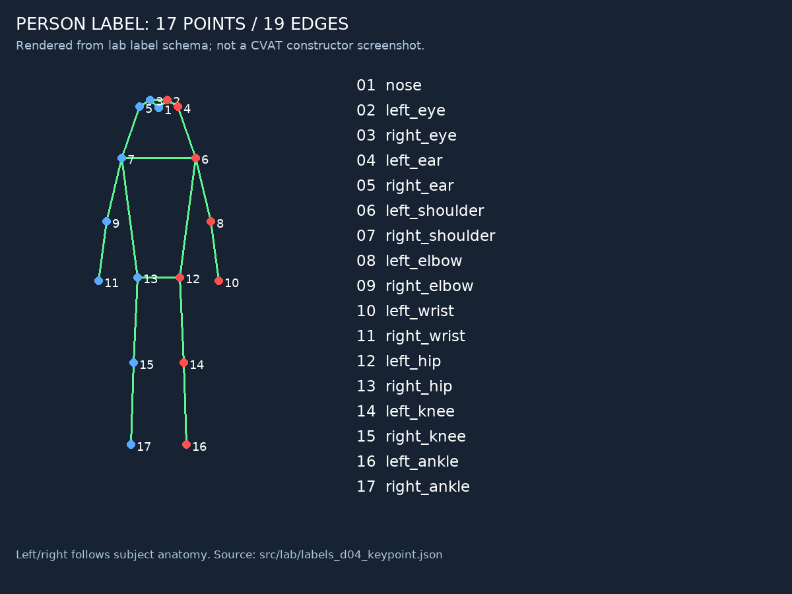
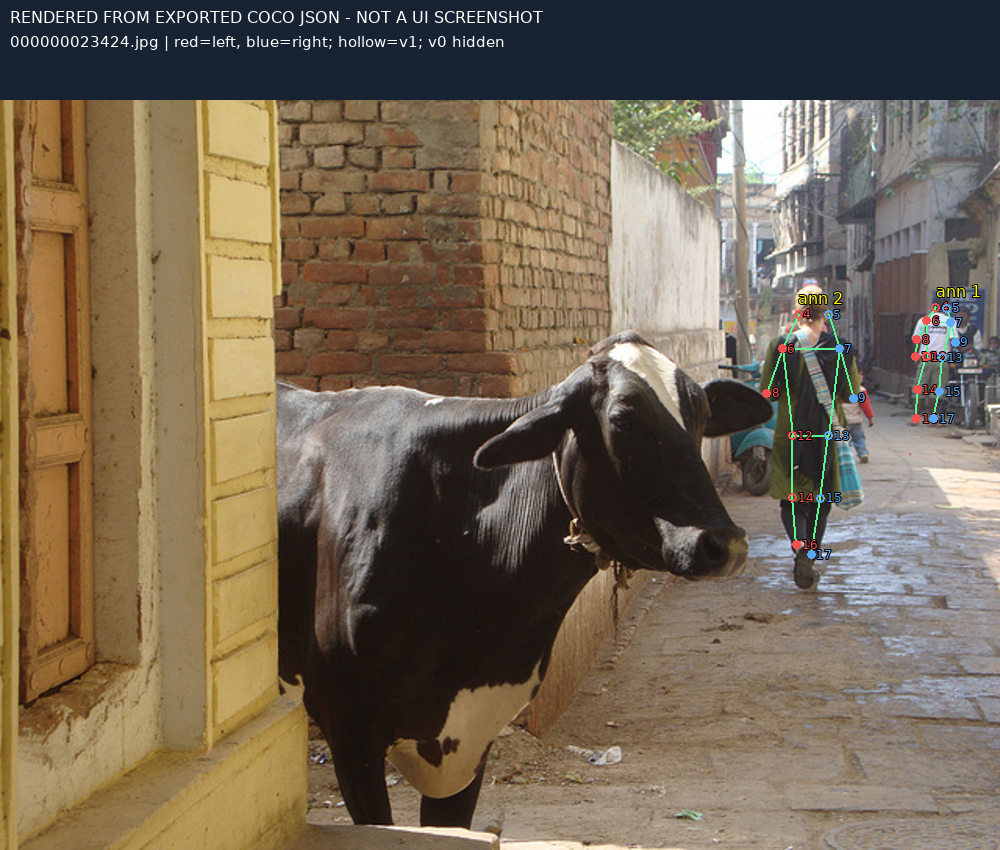
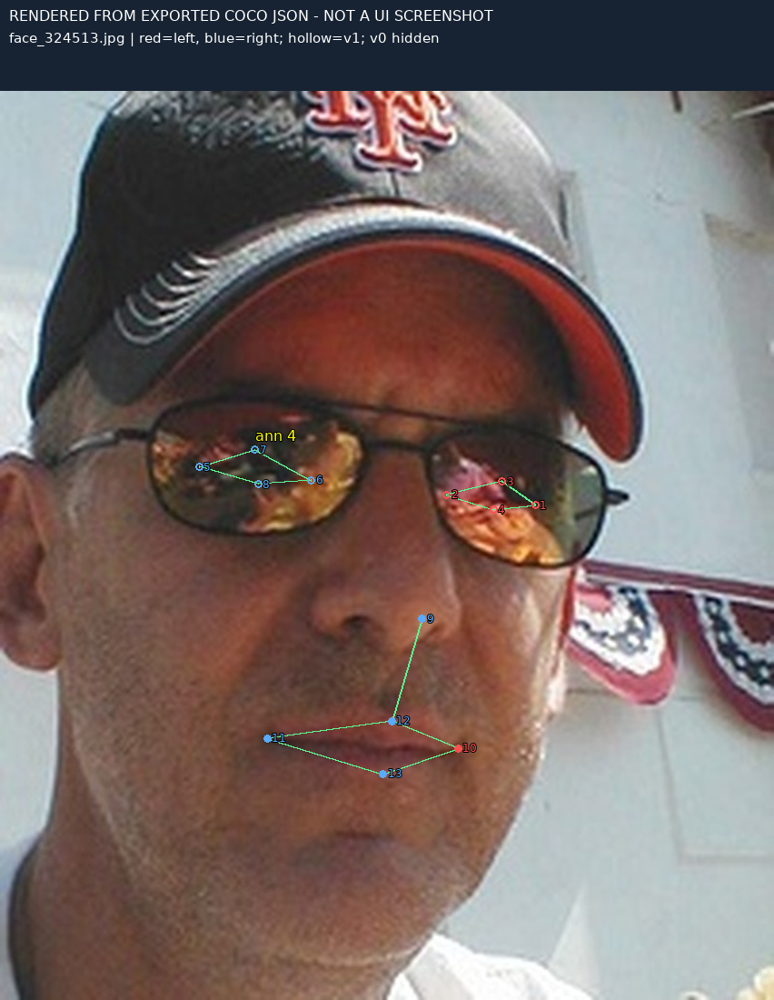
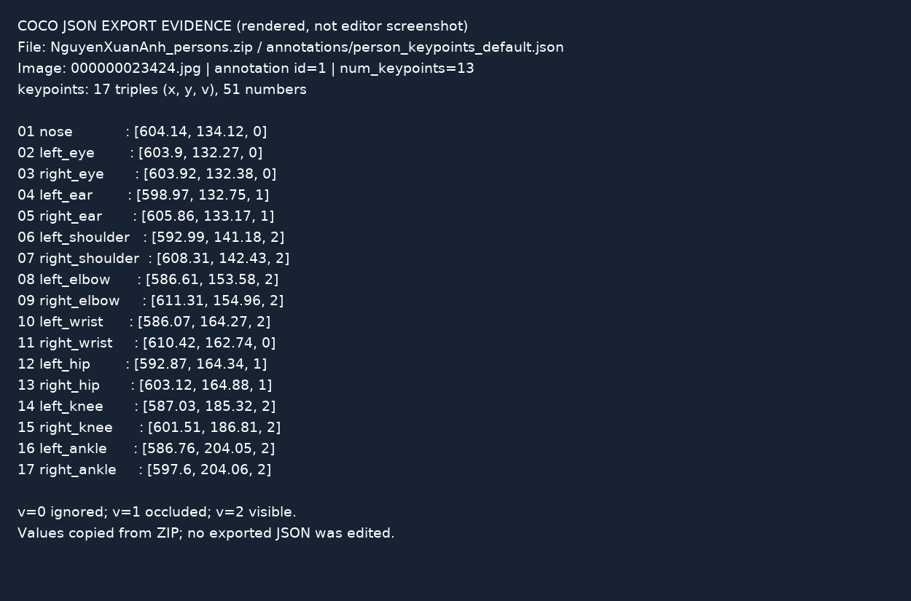

# Báo cáo cá nhân — NguyenXuanAnh-2A202603117

> Bản nháp điền từ hai ZIP người dùng đã export. Các mục trải nghiệm cá nhân còn **CHỜ BẠN ĐIỀN**; chưa xác nhận hoàn tất bài nộp. Nhãn khởi tạo bằng model, sau đó người dùng chỉnh sửa/export; xem mục 9.

Dữ liệu: 12 ảnh người COCO val2017 (Lin et al., 2014) và 8 ảnh chân dung Wikimedia Commons, chỉ dùng trong lớp.

## 0. Thông tin học viên

- Họ tên: NguyenXuanAnh (bạn kiểm tra lại cách viết có dấu)
- MSSV: 2A202603117
- Email: [CHỜ BẠN ĐIỀN]
- Link repository: https://github.com/xanhhangreal/K5-L2-DAY04-NguyenXuanAnh-2A202603117-KeypointPose
- Phiên bản CVAT (Help → About): 2.74.1 theo lần kiểm trước; hiện Docker chưa kết nối để xác nhận lại.
- Máy: Windows + Ubuntu WSL · Docker được cấp khoảng 7,6 GiB ở lần kiểm trước · RAM máy và chế độ đầy đủ/lite: [CHỜ BẠN ĐIỀN]
- Bộ ảnh (`src/exports/assignment.json`): có; MSSV và danh sách 12/8 ảnh khớp ZIP. Task/job hiện là 20/21, khác setup ban đầu 18/19; cần đối chiếu với coach.
- Giờ bắt đầu: [CHỜ BẠN ĐIỀN]
- Giờ kết thúc: [CHỜ BẠN ĐIỀN]

## 1. Kiểm tra label (CP0)

| Label | Kiểu | Số điểm | Tên điểm đúng bảng của lab? | Đúng thứ tự? | Số cạnh |
|---|---|---:|---|---|---:|
| `person` | Skeleton (theo schema/export) | 17 | Đúng trong ZIP | Đúng trong ZIP | 19 |
| `face` | Skeleton (theo schema/export) | 13 | Đúng trong ZIP | Đúng trong ZIP | 13 |

Mẫu `person` dựng theo người quay mặt về camera (các điểm `left_*` nằm bên phải khung mẫu)? [CHỜ BẠN XÁC NHẬN]

Cách đổi cờ `occluded` / `outside` cho **một điểm** trên phiên bản CVAT này (một câu):

[CHỜ BẠN ĐIỀN]

## 2. Số lượng đã gán và thời gian (CP1, CP2)

| Nhóm ảnh | Số ảnh | Số skeleton đã gán | Số người dưới 60 px (không gán) | Số poster / gương / màn hình bỏ qua | Thời gian (phút) |
|---|---:|---:|---:|---:|---:|
| `easy` | 5 | 5 | Chờ điền | Chờ điền | Chờ điền |
| `occluded` | 3 | 7 | Chờ điền | Chờ điền | Chờ điền |
| `back` | 2 | 4 | Chờ điền | Chờ điền | Chờ điền |
| `small` | 1 | 2 | Chờ điền | Chờ điền | Chờ điền |
| `crowd` | 1 | 3 | Chờ điền | Chờ điền | Chờ điền |
| `faces` | 8 | 8 | — | Chờ điền | Chờ điền |

- Số ảnh người đã xong ở mốc phút 105: ___ / 10
- Thời gian thực tế (phút): CP1 ___ · CP2 ___ · CP3 ___
- Ảnh tốn thời gian nhất là ảnh nào, vì sao?

[CHỜ BẠN ĐIỀN]

## 3. Bảng ca khó (CP1, CP2)

**CHỜ BẠN ĐIỀN từ trải nghiệm thực tế.**

Mỗi điểm bạn phân vân một dòng, nhất là phân vân giữa `v = 1` và `v = 0`, hoặc không chắc hướng người.

| Ảnh | Người / mặt | Điểm | Cờ đã chọn | Phân vân giữa | Lý do chọn |
|---|---|---|---:|---|---|
| | | | | | |
| | | | | | |
| | | | | | |

## 4. Bảng tự review (CP3)

**CHỜ BẠN ĐIỀN tối thiểu 8 dòng; không mặc định các ảnh đều `ok`.**

Đi từ ảnh cuối về ảnh đầu. 5 ảnh người (ít nhất 2 ảnh `back` hoặc `crowd`) và 3 ảnh mặt. Ít nhất 8 dòng, kể cả dòng `ok`. Ghi lỗi trước, sửa sau.

Mã lỗi dùng đúng một trong: `lr_swap`, `vis_flag`, `position`, `missing`, `extra`, `ok`.

| Ảnh | Người / mặt | Điểm | Mã lỗi | Ghi chú | Đã sửa? |
|---|---|---|---|---|---|
| | | | | | |
| | | | | | |
| | | | | | |
| | | | | | |
| | | | | | |
| | | | | | |
| | | | | | |
| | | | | | |

Tổng hợp số lỗi theo mã:

| `lr_swap` | `vis_flag` | `position` | `missing` | `extra` | `ok` |
|---:|---:|---:|---:|---:|---:|
| | | | | | |

Điểm còn phân vân giữa `v = 1` và `v = 0` (ghi cả hai lựa chọn và lý do chọn):

[CHỜ BẠN ĐIỀN]

## 5. Kiểm file xuất và kết quả tự kiểm (CP4)

Kiểm tra JSON bằng công cụ (học viên cần tự đối chiếu lại theo CP4):

| File | Người / mặt kiểm (ảnh, thứ tự) | Số phần tử `keypoints` | Điểm `outside` ra `v = 0`, `occluded` ra `v = 1`? | `num_keypoints` khớp? |
|---|---|---:|---|---|
| `NguyenXuanAnh_persons.zip` | `000000023424.jpg`, annotation id=1 | 51 | v=0: 4, v=1: 4, v=2: 9; cần đối chiếu UI | Có: 13 |
| `NguyenXuanAnh_persons.zip` | `000000469061.jpg`, annotation id=18 | 51 | v=0: 3, v=1: 5, v=2: 9; cần đối chiếu UI | Có: 14 |
| `NguyenXuanAnh_faces.zip` | `face_324513.jpg`, annotation id=4 | 39 | v=0: 0, v=1: 8, v=2: 5; cần đối chiếu UI | Có: 13 |

Trong ZIP có các cờ 0/1/2; quy ước CVAT là `occluded → v=1`, `outside → v=0`. Có 70 điểm v=0 giữ tọa độ khác 0, không phải lỗi định dạng. Chưa đối chiếu lại cờ trên giao diện CVAT của bản sửa cuối.

Hai job đã chuyển sang completed trên CVAT? [CHỜ BẠN XÁC NHẬN]

Dán phần **TÓM TẮT** in ra từ `src/check_submission.py`:

```text
- File person: NguyenXuanAnh_persons.zip
  Số ảnh: 12 · số skeleton `person`: 21 · mỗi annotation 51 số
  Skeleton theo ảnh: 000000023424=2, 000000043500=2, 000000057978=1, 000000103970=1, 000000150192=2, 000000205650=1, 000000240340=1, 000000261732=1, 000000332273=3, 000000461389=3, 000000469061=2, 000000516902=2
  Cờ v: v=2 222 (62%) · v=1 65 (18%) · v=0 70 (20%)
  num_keypoints trung bình: 13.7
- File face: NguyenXuanAnh_faces.zip
  Số ảnh: 8 · số skeleton `face`: 8 · mỗi annotation 39 số
  Skeleton theo ảnh: face_141135=1, face_145621=1, face_279764=1, face_324513=1, face_3348=1, face_421231=1, face_442231=1, face_514826=1
  Cờ v: v=2 96 (92%) · v=1 8 (8%) · v=0 0 (0%)
  num_keypoints trung bình: 13.0
- Ghi chú: 70 điểm v = 0 vẫn mang tọa độ cũ (CVAT 2.x xuất như vậy; chuẩn COCO ghi 0, 0). Không phải lỗi: điểm v = 0 bị bỏ qua khi huấn luyện và khi chấm.
- Số [LỖI]: 0 · số [CẢNH BÁO]: 3
Kết quả: ĐẠT (đọc lại từng cảnh báo ở trên)
```

Các `[CẢNH BÁO]` cần bạn kiểm tra và ghi lý do giữ/sửa:

- [CẢNH BÁO] 000000150192.jpg #2: các điểm chỉ trải cao 43 px (< 60 px). Người dưới 60 px không gán; nếu người cao hơn nhưng bị cắt khung thì bỏ qua cảnh báo này.
- [CẢNH BÁO] 000000332273.jpg #2: cặp ankle nằm ngược phía so với các cặp còn lại. Có thể đổi trái/phải một cặp (`lr_swap`), hoặc tay / chân bắt chéo thật: kiểm lại.
- [CẢNH BÁO] 000000469061.jpg #2: cặp elbow, wrist nằm ngược phía so với các cặp còn lại. Có thể đổi trái/phải một cặp (`lr_swap`), hoặc tay / chân bắt chéo thật: kiểm lại.

[CHỜ BẠN ĐIỀN kết luận thực tế, chưa đánh dấu đã xử lý.]

## 6. Ảnh chụp màn hình

**Còn thiếu cả 4 ảnh dưới đây.** Docker/CVAT chưa kết nối ở lượt kiểm này; chưa có ảnh màn hình của bản nhãn mới.

1. Label `person` trong label constructor (đủ 17 điểm có tên):

   

2. Một người quay lưng đã gán, cờ đã đặt:

   

3. Một khuôn mặt đã gán 13 điểm, phóng to vùng mắt:

   

4. Một đoạn JSON xuất của một người:

   

Nguồn ảnh: COCO val2017 / Wikimedia Commons.

## 7. Tự đánh giá

**CHỜ BẠN ĐIỀN.**

1. Lỗi bạn mắc nhiều nhất hôm nay, và cách bạn sẽ tránh ở dự án thật:

   [CHỜ BẠN ĐIỀN]

2. Một quy tắc bạn đề xuất thêm vào guideline (kèm ảnh ví dụ nếu có):

   [CHỜ BẠN ĐIỀN]

3. Nhãn của bạn đi vào model ở đâu? Chọn một lỗi bạn đã sửa và nói nó sẽ làm model học sai thế nào (heatmap, trọng số trong loss, hay bước lật ảnh):

   [CHỜ BẠN ĐIỀN]

## 8. Khó khăn và lỗi kỹ thuật

- Khi trợ lý kiểm sau export, Docker báo không kết nối được `dockerDesktopLinuxEngine`; chưa xác minh job completed hoặc chụp giao diện CVAT. Hai ZIP được kiểm offline thành công.
- Khó khăn bạn gặp trong lúc làm: [CHỜ BẠN ĐIỀN].

## Bonus (nếu làm)

### B1 — 3 ảnh người khó thêm

| Ảnh | Số skeleton | Số người dưới 60 px | Ca khó nhất |
|---|---:|---:|---|
| | | | |
| | | | |
| | | | |

Kết quả `src/check_submission.py` cho `HoVaTen_bonus_persons.zip`:

```text
- File person: NguyenXuanAnh_persons.zip
  Số ảnh: 12 · số skeleton `person`: 21 · mỗi annotation 51 số
  Skeleton theo ảnh: 000000023424=2, 000000043500=2, 000000057978=1, 000000103970=1, 000000150192=2, 000000205650=1, 000000240340=1, 000000261732=1, 000000332273=3, 000000461389=3, 000000469061=2, 000000516902=2
  Cờ v: v=2 222 (62%) · v=1 65 (18%) · v=0 70 (20%)
  num_keypoints trung bình: 13.7
- File face: NguyenXuanAnh_faces.zip
  Số ảnh: 8 · số skeleton `face`: 8 · mỗi annotation 39 số
  Skeleton theo ảnh: face_141135=1, face_145621=1, face_279764=1, face_324513=1, face_3348=1, face_421231=1, face_442231=1, face_514826=1
  Cờ v: v=2 96 (92%) · v=1 8 (8%) · v=0 0 (0%)
  num_keypoints trung bình: 13.0
- Ghi chú: 70 điểm v = 0 vẫn mang tọa độ cũ (CVAT 2.x xuất như vậy; chuẩn COCO ghi 0, 0). Không phải lỗi: điểm v = 0 bị bỏ qua khi huấn luyện và khi chấm.
- Số [LỖI]: 0 · số [CẢNH BÁO]: 3
Kết quả: ĐẠT (đọc lại từng cảnh báo ở trên)
```

### B2 — 5 ảnh khuôn mặt đen trắng / hồng ngoại

Ảnh không màu khó hơn ở điểm nào? Kính râm trên ảnh hồng ngoại có còn là `v = 1` không?

[CHỜ BẠN ĐIỀN]

### B3 — Model so với nhãn của tôi (không tính điểm)

- Demo đã dùng:
- Ảnh đã thử:

1. Model có trả điểm cho khớp bị che, hay khớp ngoài ảnh không? Confidence ở các điểm đó thế nào?

   [CHỜ BẠN ĐIỀN]

2. Với người quay lưng, model có đổi trái/phải không?

   [CHỜ BẠN ĐIỀN]

3. Bộ điểm của model có giống 17 điểm COCO không?

   [CHỜ BẠN ĐIỀN]

## 9. Tài liệu tham khảo và công cụ AI đã dùng

- README.md, CHECKPOINTS.md, docs/GUIDELINE.md, docs/CVAT_CHEATSHEET.md và SUBMISSION.md của lab.
- Codex: xây tool local; YOLO11m Pose sinh đề xuất 17 điểm người; MediaPipe FaceLandmarker sinh đề xuất ánh xạ 13 điểm mặt; trợ lý kiểm overlay và cờ.
- Người dùng thông báo đã hoàn thành chỉnh sửa và export. So với bản tự động, ZIP mới thay đổi nội dung keypoint ở 9 ảnh người và 1 ảnh mặt; tổng người giảm 23 xuống 21. So sánh file không chứng minh đã thực hiện đủ quy trình tự review.
- Codex kiểm ZIP và điền thông tin khách quan trong báo cáo; mục 3, 4, 7 và thời gian do học viên tự điền.
- RULES.md yêu cầu gán tay và không công nhận điểm do model sinh như nhãn tự gán; cần trao đổi coach về việc sử dụng kết quả này.
